# Hoard

A self-hosted dashboard for a Klipper 3D printer, for the person who keeps every print, every spool and every project.

It shows the printer live, records what each print cost (filament and electricity), keeps the history, and groups prints, files, links and notes into projects. It is built for one printer and one household, and it is opinionated; see [What it expects](#what-it-expects).

The [wiki](https://github.com/stevendejongnl/Hoard/wiki) has the guides: installing, configuring, how it works, developing, and using Hoard from an MCP client.

| Dashboard | History |
|---|---|
| 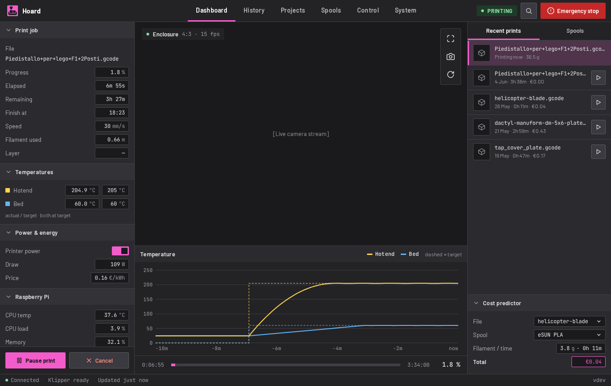 | 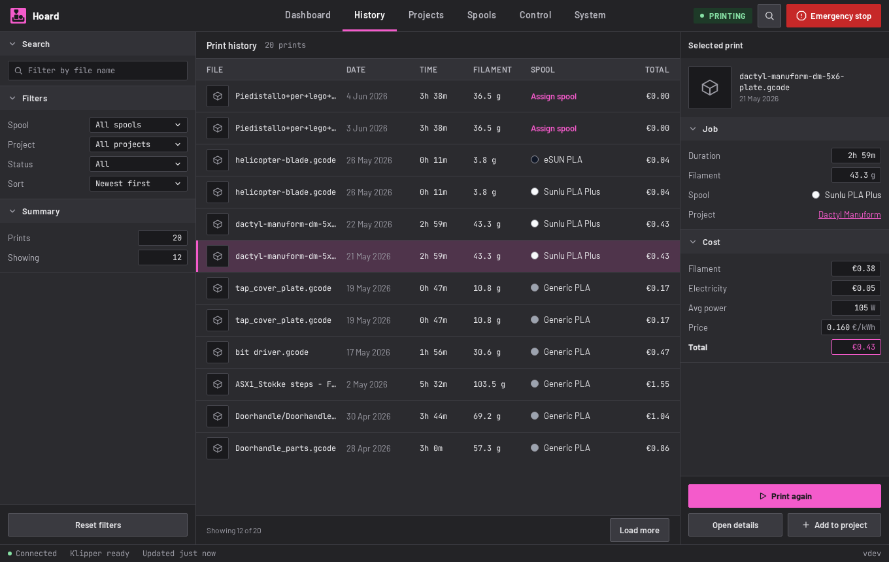 |
| **Projects** | **Spools** |
| 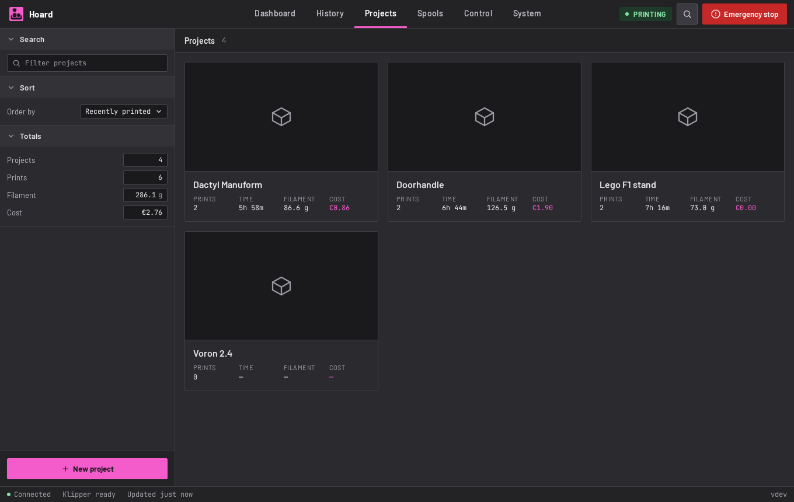 | 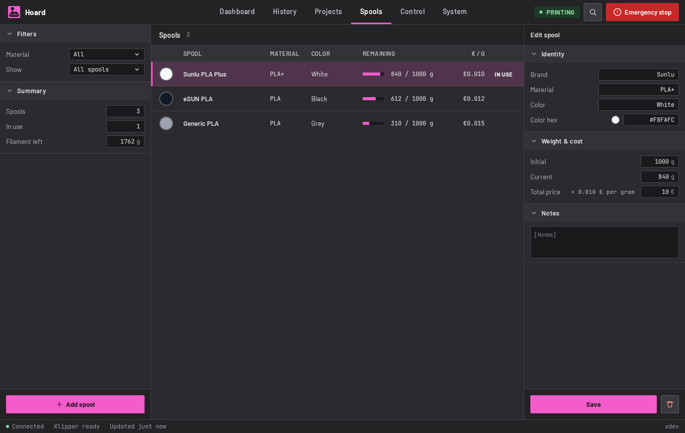 |

It works on a phone as well, with the same features as on desktop: printer power and the other switches, starting a print, the cost predictor, search and the camera buttons. It installs as an app (PWA).

| Dashboard | History | Spools | Edit a spool |
|---|---|---|---|
| 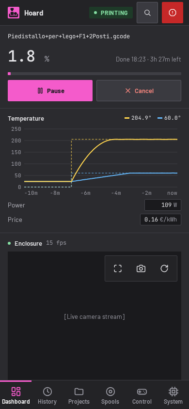 | 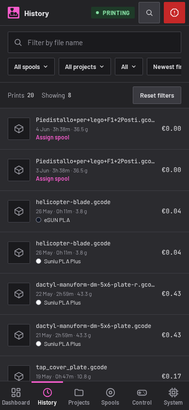 | 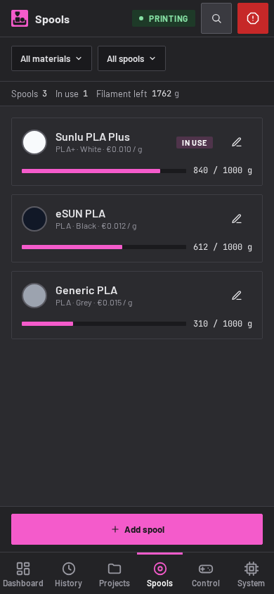 | 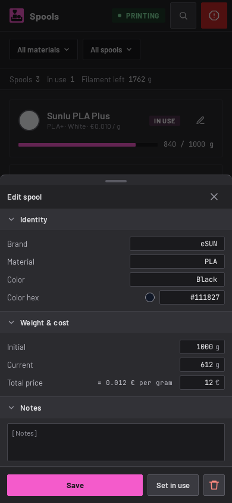 |

The Control page moves, heats and tunes the printer from cards, and the System page shows what the printer's host and boards report.

| Control | System | Control (phone) |
|---|---|---|
| 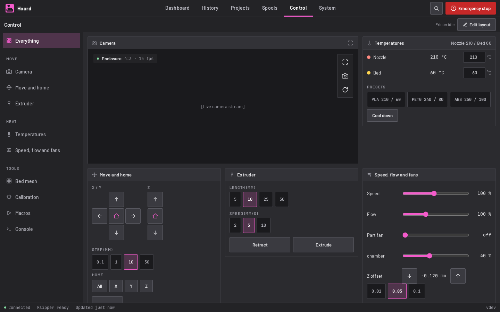 | 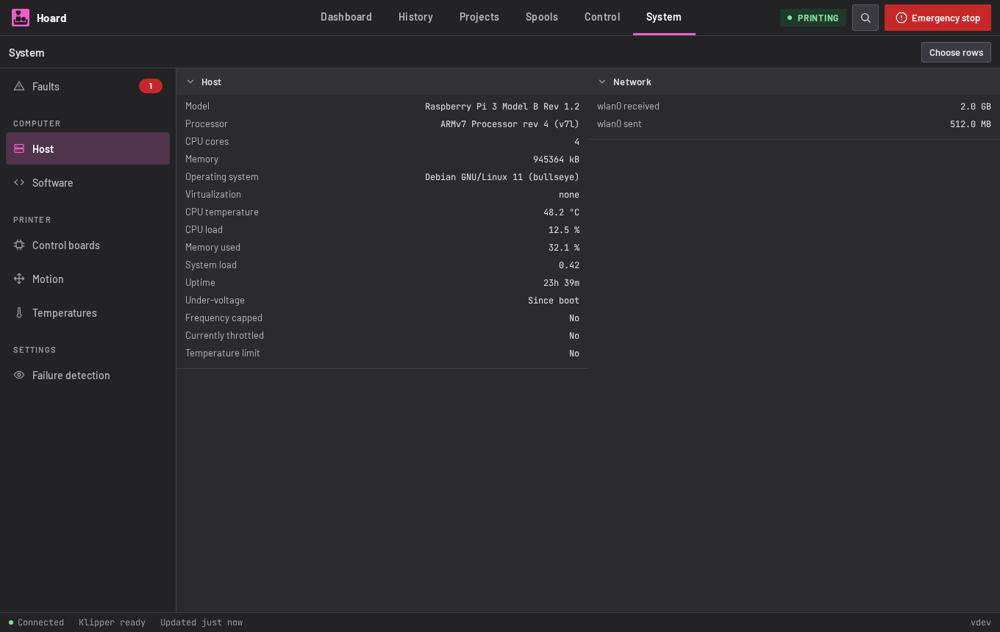 | 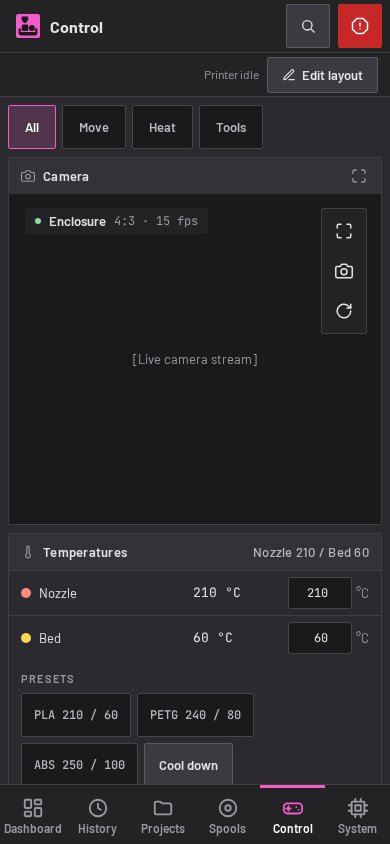 |

| Macros | Console |
|---|---|
| 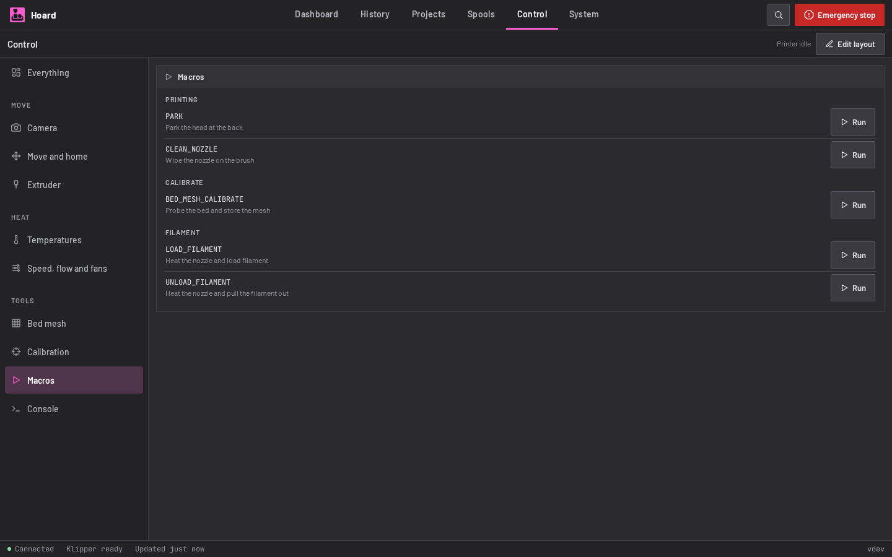 | 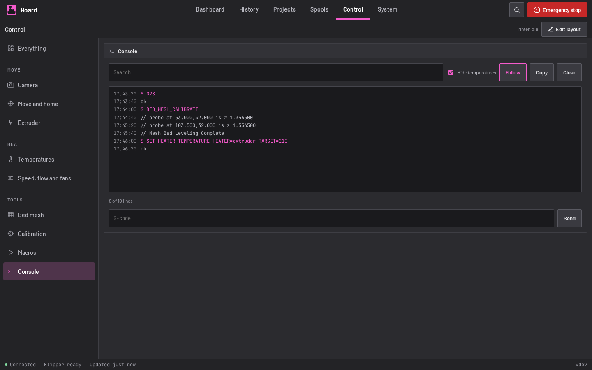 |

Print failure detection is optional and off until you give it a detector ([how](https://github.com/stevendejongnl/Hoard/wiki/Failure-detection)). When a print looks failed, a banner shows the image and asks whether the alert was real; the settings, including whether Hoard only notifies or also pauses the print, are on the Failure detection page of the System page.

| A failed print | The Detections page | Settings |
|---|---|---|
| 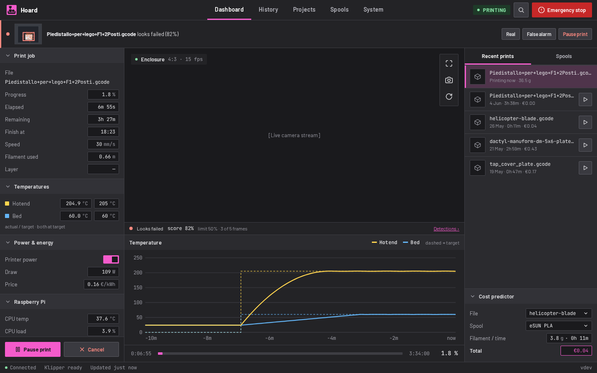 | 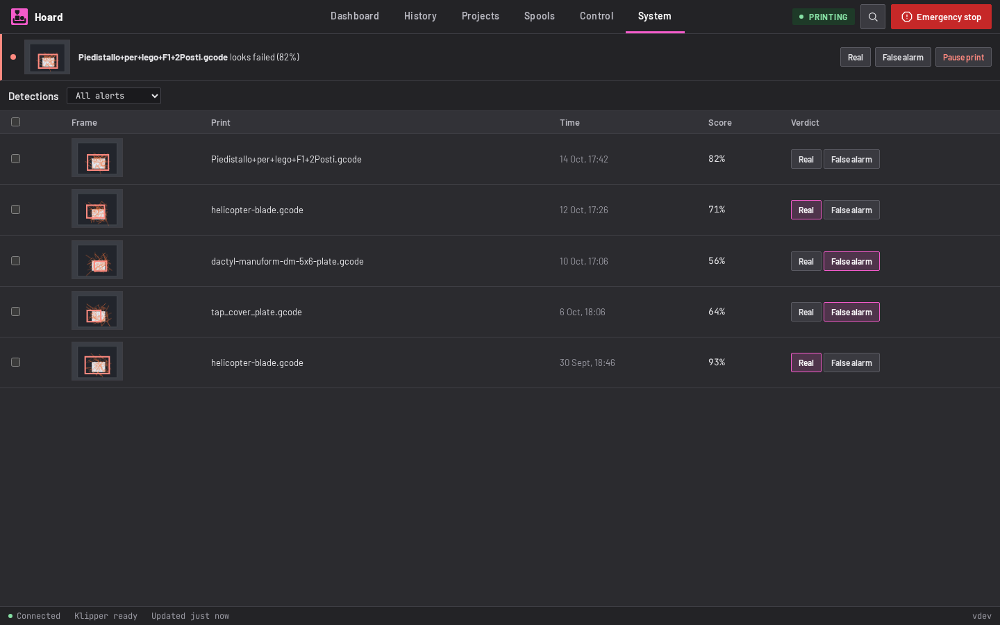 | 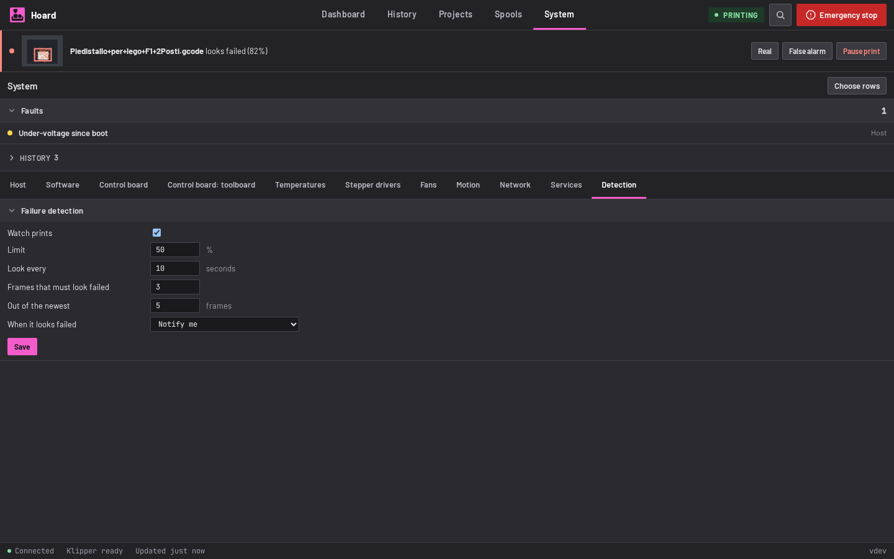 |

The screenshots are taken from the app filled with sample data (`python3 -m frontend.parity.take_screenshots`).

## What it does

- **Live printer.** Status, progress, temperatures with a ten-minute chart, the camera, power and the Raspberry Pi's load. Pause, resume, cancel, emergency stop, firmware restart, and power on or off for the printer and for any other switch you configure (a power strip, the Pi, a filament dryer). The printer is switched off by itself after a set idle time, and Klipper is brought back when the power comes on.
- **Print history with costs.** Each print gets its filament cost (from the spool you assign) and its electricity cost (the power the printer drew, at the price of that hour). Prices and costs can be recalculated.
- **Cost predictor.** Pick a G-code file and a spool and see the filament, the time and the cost before you print. The print-ready step confirms the file and helps you recover from a powered-off printer or a firmware error.
- **Spools.** Brand, material, colour, weight and price per gram, what is left, and which spool is in use. A spool can be linked to an NFC tag and found again by scanning it (Web NFC: Chrome on Android). A tag that holds an [OpenPrintTag](https://github.com/OpenPrintTag/openprinttag-specification) (Prusament) or an [OpenSpool](https://github.com/spuder/OpenSpool) record fills in a new spool.
- **Projects.** A project holds notes (Markdown), links with a preview, files (STL and G-code, with thumbnails; a G-code file can be printed from the project, after a confirmation) and the prints made for it, with their totals. A project can have a cover image: set it from an image file on the printer (Hoard keeps a copy) or from the address of an image, such as a print photo, with the API or the MCP tools `set_project_cover` and `clear_project_cover`. `import_printer_file` copies a file from the printer, such as a source 3MF, into the project so it can be downloaded.
- **Print detail.** The job, the cost breakdown, and photos of the result.
- **Search.** A command palette over prints, projects and spools (`/`).
- **Notifications.** Web push when a print finishes or fails.
- **Failure detection (optional).** A detector judges the camera while a print runs. When enough of the newest images look failed, a banner on every page shows the image with the buttons Real and False alarm, a push notification opens the Detections page, and the print is paused if you chose that. Your verdicts suggest a limit, and the labelled images download as a dataset. It stays off and hidden until you set a detector: Obico's `ml_api` in a container of its own, or a vision model, which is a service outside your network. See the wiki's Failure detection page.
- **Appearance.** One accent colour, set by hex in the status bar.
- **Control.** Move, home, heat and tune the printer from cards: a camera (with its measured frame rate, a view menu for fit, fill, stretch, rotate and flip, and a snapshot that keeps the turns; also on a screen of its own, with the move pad and the Z babystep), move and home, temperatures with presets, the extruder, speed, flow, fans and the Z offset, the bed mesh, calibration (bed mesh, screws tilt, manual probe), macros and a console. The macros are grouped in the categories you made in Fluidd, each with its description. The console shows the time of every line, searches, hides the temperature reports, stops following when you scroll up, and copies what it shows. The cards can be dragged, made one to three columns wide and hidden, and the layout is saved by itself, once for the desktop and once for the phone. While a print runs, moving, the extruder, macros, the console and calibration are locked by the server. An MCP client has to be allowed by you on the page, for 30 minutes at a time, before it may move or heat the printer, start a print or put a file on it. Covered by automated tests with a fake printer and checked in a browser with made-up data; not yet run against a real printer. See the wiki's Control page.
- **Klipper banner.** A slim strip under the top bar while Klipper is not ready: its state and message, Restart Klipper and Firmware restart, and the two logs to download. The top bar also links to Fluidd or Mainsail when the printer host has one installed.
- **System.** What the printer's host and control boards report, whatever the hardware is, with the active faults and, behind a toggle, a history of them. Related sections share a page (the host with its network, the software with its services, the control boards, motion with the stepper drivers, temperatures with fans), listed by heading, so the page stays short. Under-voltage shows on a host that reports it. Rows and sections can be hidden.

## What it expects

Hoard talks to what is already in the house:

| Service | Used for | Setting |
|---|---|---|
| Moonraker (Klipper) | printer state, files, camera, temperature history, control | `MOONRAKER_URL`, `MOONRAKER_WS` |
| Home Assistant | printer power draw, electricity price, energy and the power switch | `HA_URL`, `HA_TOKEN`, and the entity names below |
| InfluxDB | stores power, electricity prices and print costs | `INFLUXDB_URL`, `INFLUXDB_TOKEN`, `INFLUXDB_ORG`, `INFLUXDB_BUCKET` |
| Redis | caches the lists | `REDIS_URL` |
| A detector (optional) | failure detection | `DETECTOR_BACKEND`, `DETECTOR_URL`, `VISION_API_KEY` |

The Home Assistant entities are settings, so you map them to the names of your own setup:

| Setting | Default | What it is |
|---|---|---|
| `HA_POWER_SENSOR` | `sensor.3d_printer_power` | the power the printer draws (W) |
| `HA_PRICE_SENSOR` | `sensor.electricity_price_all_in` | the price per kWh, all in |
| `HA_POWER_SWITCH` | `switch.3d_printer` | the switch that powers the printer |
| `HA_SWITCHES` | none | more switches to control from the dashboard, as a JSON list in display order where a switch can require another (for example `[{"label": "Pi", "entity": "switch.pi_outlet"}, {"label": "Printer power", "printer": true, "requires": "Pi"}]`), or as `Label=entity` pairs separated by commas; any switch, light or input_boolean works. See the wiki's Configuration page |
| `HA_ENERGY_SENSORS` | `sensor.3d_printer_energy` | energy in kWh, comma separated, oldest first (keep the sensors of a plug you replaced) |

The price is read from the price sensor and written to InfluxDB every half hour, so the cost of a print is worked out with the price of its own hours. The filament weight is derived from the length with the density of PLA for 1.75 mm filament.

## Run it

You need the services above. Copy `.env.example` to `.env`, fill it in, and start it with Docker:

```bash
cp .env.example .env
docker compose up --build
```

The app listens on port 8765. `docker-compose.yml` starts Redis next to it, and keeps the database in a volume. The images are built and published by the release workflow as `ghcr.io/stevendejongnl/hoard`. The `k8s/` folder has the manifests I deploy with.

Web push needs a VAPID key pair (`VAPID_PUBLIC_KEY`, `VAPID_PRIVATE_KEY`, `VAPID_SUBJECT`). Without it the bell stays hidden.

## Develop

Backend: Python 3.12+ with [`uv`](https://docs.astral.sh/uv/), FastAPI and SQLite. Frontend: Lit, TypeScript and Vite.

```bash
uv sync --group dev          # backend dependencies
cd frontend && npm install   # frontend dependencies
uv run uvicorn app.main:app --reload --port 8766     # backend (the dev server proxies to 8766)
npm run dev                  # frontend, in frontend/
```

| Command | What it does |
|---|---|
| `uv run pytest` | backend tests |
| `uv run ruff check` | backend lint (also complexity and naming) |
| `npm test` (in `frontend/`) | frontend tests |
| `npm run lint` | ESLint, with no warnings allowed |
| `npm run typecheck` and `npm run typecheck:tests` | TypeScript |
| `npm run parity` | compares every screen with the design, pixel by pixel; see `frontend/parity/README.md` |

Code is written test first, with a failing test committed before the code that makes it pass, and with the rules that the lint enforces: dependencies are injected, names are whole words, functions are short and flat, and a function returns what its name says.

Releases are automatic: commits to `main` follow [Conventional Commits](https://www.conventionalcommits.org/), semantic-release makes the version, the image is built and the deployment restarts.

## Layout

```
app/              FastAPI backend: routes, SQLite, the Moonraker, Home Assistant and InfluxDB clients
frontend/         Lit + Vite app. src/ is the code, parity/ the comparison with the design
frontend/parity/  Renders the app with sample data and compares it with the design boards
docs/screenshots/ The screenshots above
k8s/              Kubernetes manifests
tests/            Backend tests
```

## License

AGPL-3.0, see [LICENSE](LICENSE).
