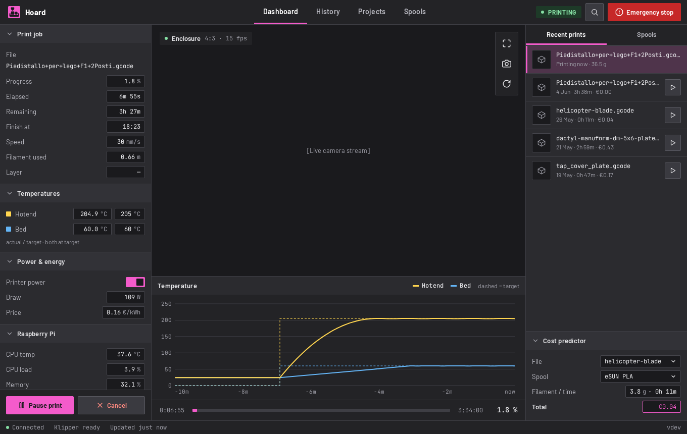
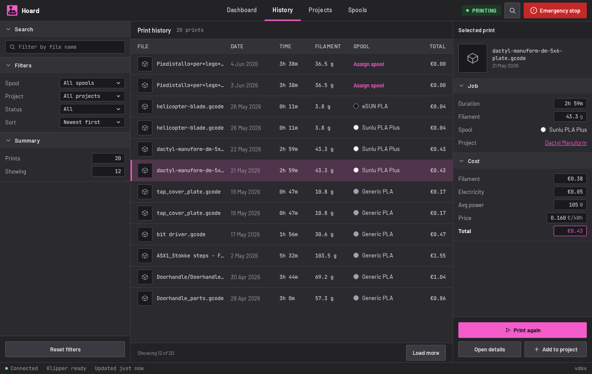
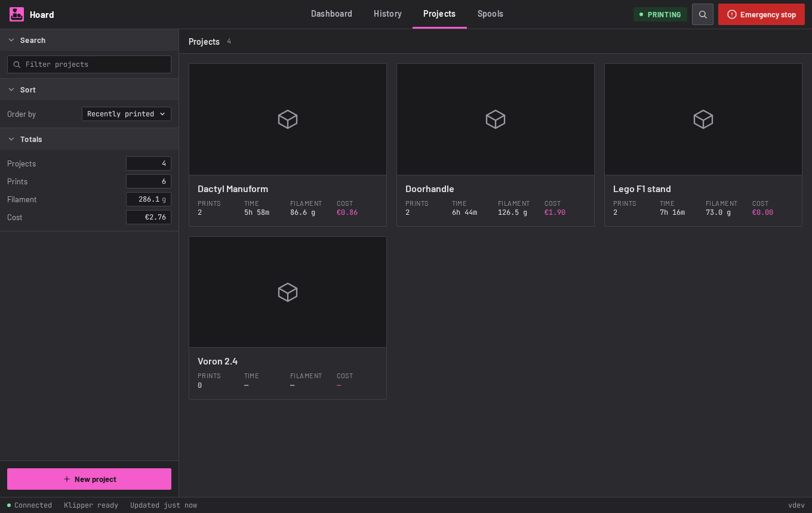
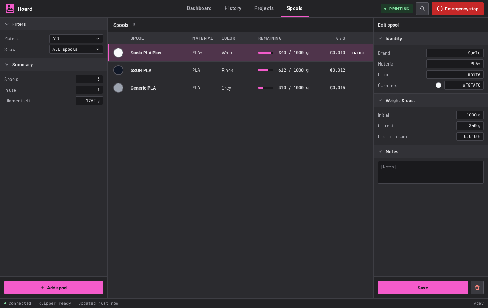
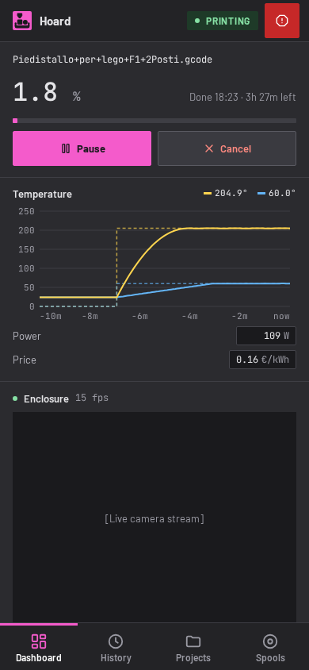
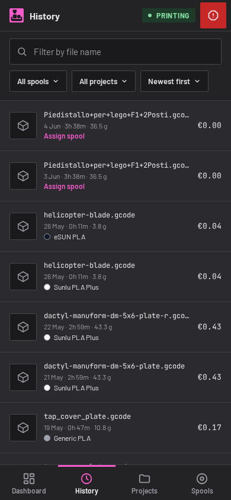
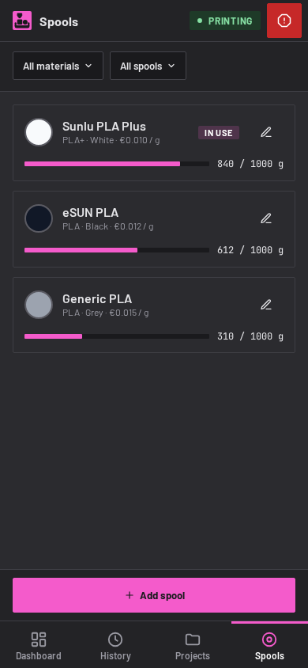
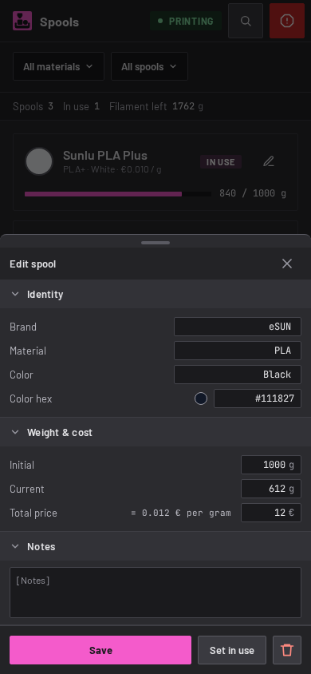

# Hoard

A self-hosted dashboard for a Klipper 3D printer, for the person who keeps every print, every spool and every project.

It shows the printer live, records what each print cost (filament and electricity), keeps the history, and groups prints, files, links and notes into projects. It is built for one printer and one household, and it is opinionated; see [What it expects](#what-it-expects).

The [wiki](https://github.com/stevendejongnl/Hoard/wiki) has the guides: installing, configuring, how it works, and developing.

| Dashboard | History |
|---|---|
|  |  |
| **Projects** | **Spools** |
|  |  |

It works on a phone as well, and installs as an app (PWA).

| Dashboard | History | Spools | Edit a spool |
|---|---|---|---|
|  |  |  |  |

The screenshots are taken from the app filled with sample data (`python3 -m frontend.parity.take_screenshots`).

## What it does

- **Live printer.** Status, progress, temperatures with a ten-minute chart, the camera, power and the Raspberry Pi's load. Pause, resume, cancel, emergency stop, firmware restart, and power on or off for the printer and for any other switch you configure (a power strip, the Pi, a filament dryer).
- **Print history with costs.** Each print gets its filament cost (from the spool you assign) and its electricity cost (the power the printer drew, at the price of that hour). Prices and costs can be recalculated.
- **Cost predictor.** Pick a G-code file and a spool and see the filament, the time and the cost before you print. The print-ready step confirms the file and helps you recover from a powered-off printer or a firmware error.
- **Spools.** Brand, material, colour, weight and price per gram, what is left, and which spool is in use. A spool can be linked to an NFC tag and found again by scanning it (Web NFC: Chrome on Android).
- **Projects.** A project holds notes (Markdown), links with a preview, files (STL and G-code, with thumbnails) and the prints made for it, with their totals.
- **Print detail.** The job, the cost breakdown, and photos of the result.
- **Search.** A command palette over prints, projects and spools (`/`).
- **Notifications.** Web push when a print finishes or fails.
- **Appearance.** One accent colour, set by hex in the status bar.

## What it expects

Hoard talks to what is already in the house:

| Service | Used for | Setting |
|---|---|---|
| Moonraker (Klipper) | printer state, files, camera, temperature history, control | `MOONRAKER_URL`, `MOONRAKER_WS` |
| Home Assistant | printer power draw, electricity price, energy and the power switch | `HA_URL`, `HA_TOKEN`, and the entity names below |
| InfluxDB | stores power, electricity prices and print costs | `INFLUXDB_URL`, `INFLUXDB_TOKEN`, `INFLUXDB_ORG`, `INFLUXDB_BUCKET` |
| Redis | caches the lists | `REDIS_URL` |

The Home Assistant entities are settings, so you map them to the names of your own setup:

| Setting | Default | What it is |
|---|---|---|
| `HA_POWER_SENSOR` | `sensor.3d_printer_power` | the power the printer draws (W) |
| `HA_PRICE_SENSOR` | `sensor.electricity_price_all_in` | the price per kWh, all in |
| `HA_POWER_SWITCH` | `switch.3d_printer` | the switch that powers the printer |
| `HA_SWITCHES` | none | more switches to control from the dashboard, as `Label=entity` pairs separated by commas (for example `Pi=switch.pi_outlet,Filament dryer=switch.dryer_outlet`); any switch, light or input_boolean works |
| `HA_ENERGY_SENSORS` | `sensor.3d_printer_energy` | energy in kWh, comma separated, oldest first (keep the sensors of a plug you replaced) |

The price is read from the price sensor and written to InfluxDB every half hour, so the cost of a print is worked out with the price of its own hours. The filament weight is derived from the length with the density of PLA for 1.75 mm filament.

## Run it

You need the services above. Copy `.env.example` to `.env`, fill it in, and start it with Docker:

```bash
cp .env.example .env
docker compose up --build
```

The app listens on port 8765. `docker-compose.yml` starts Redis next to it, and keeps the database in a volume. The images are built and published by the release workflow as `ghcr.io/stevendejongnl/hoard`. The `k8s/` folder has the manifests I deploy with.

Web push needs a VAPID key pair (`VAPID_PUBLIC_KEY`, `VAPID_PRIVATE_KEY`, `VAPID_SUBJECT`). Without it the bell stays hidden.

## Develop

Backend: Python 3.12+ with [`uv`](https://docs.astral.sh/uv/), FastAPI and SQLite. Frontend: Lit, TypeScript and Vite.

```bash
uv sync --group dev          # backend dependencies
cd frontend && npm install   # frontend dependencies
uv run uvicorn app.main:app --reload --port 8766     # backend (the dev server proxies to 8766)
npm run dev                  # frontend, in frontend/
```

| Command | What it does |
|---|---|
| `uv run pytest` | backend tests |
| `uv run ruff check` | backend lint (also complexity and naming) |
| `npm test` (in `frontend/`) | frontend tests |
| `npm run lint` | ESLint, with no warnings allowed |
| `npm run typecheck` and `npm run typecheck:tests` | TypeScript |
| `npm run parity` | compares every screen with the design, pixel by pixel; see `frontend/parity/README.md` |

Code is written test first, with a failing test committed before the code that makes it pass, and with the rules that the lint enforces: dependencies are injected, names are whole words, functions are short and flat, and a function returns what its name says.

Releases are automatic: commits to `main` follow [Conventional Commits](https://www.conventionalcommits.org/), semantic-release makes the version, the image is built and the deployment restarts.

## Layout

```
app/              FastAPI backend: routes, SQLite, the Moonraker, Home Assistant and InfluxDB clients
frontend/         Lit + Vite app. src/ is the code, parity/ the comparison with the design
frontend/parity/  Renders the app with sample data and compares it with the design boards
docs/screenshots/ The screenshots above
k8s/              Kubernetes manifests
tests/            Backend tests
```

## License

AGPL-3.0, see [LICENSE](LICENSE).
